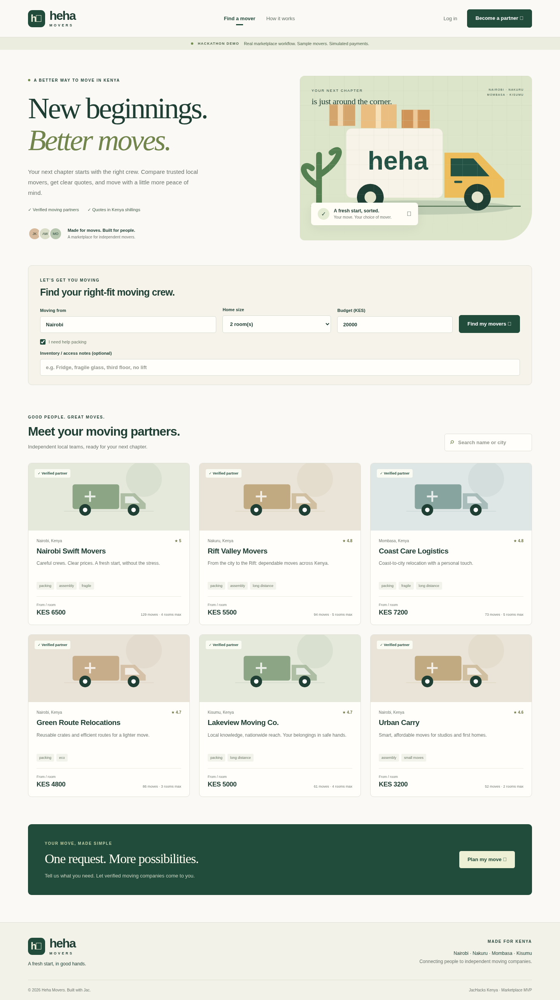
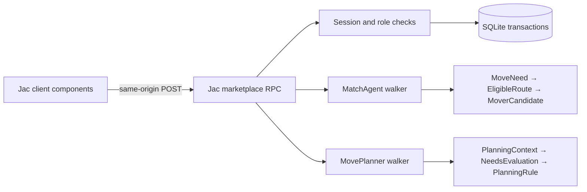

# Heha Movers

**New beginnings. Better moves.**

A fullstack Kenyan moving-services **marketplace**, built in Jac for JacHacks Kenya. Customers compare independent moving companies, request firm quotes, choose a crew, coordinate their move and leave a verified-booking review. Movers manage leads and jobs; admins verify moving partners.



## What works

- Browse and search six clearly labelled sample moving companies across Nairobi, Nakuru, Mombasa and Kisumu.
- An explainable **Jac graph matching agent** filters verification, household capacity and packing requirements, then ranks companies by pickup area, reputation and indicative budget fit.
- A second **Jac planning walker** evaluates 17 preparation rules, explains evidence, flags fragile belongings, appliances, stairs and heavy items, and creates a saved moving checklist.
- Customer and mover registration, password hashing, expiring sessions and server-enforced roles.
- Customer moving requests with date, route, room count, inventory/access notes, packing and budget in KES.
- Verified movers submit or revise quotes. A customer accepts one quote; competing quotes are declined transactionally.
- Booking stages: `requested → confirmed → in_transit → completed`; cancellation is supported before pickup.
- A **simulated** 30% deposit with an auditable demo reference. No money is collected.
- Private booking messages between the customer and the **accepted** mover, a persistent preparation checklist, booking history and one review per completed booking.
- Admin company verification/revocation and marketplace booking oversight.
- Responsive screens, loading/error/empty states, keyboard focus and mobile layout.

The frontend, backend, graph agents, domain tests and browser acceptance script are authored in **Jac**. CSS provides presentation. The app does not depend on the old Tuzidi frontend or its unavailable hosted backend.

## Run locally

Prerequisites: **Python 3.12+**, Node.js 20+ recommended, Git and package-registry access. Validated with Python 3.12, Node 24.19.0, Jac 0.16.7 and jac-client 0.3.25. Jac installs its project-local Bun tool when preparing client dependencies.

```bash
git clone https://github.com/immanuelcherui1/heha.git
cd heha
python3 -m venv .venv
source .venv/bin/activate
python -m pip install -r requirements.txt
jac install
jac build main.jac
jac start main.jac --port 8000
```

Open the server address shown by Jac in a local browser. The client and backend use the **same origin**, so no external API URL or CORS workaround is needed. The initial request creates the SQLite schema and, in demo mode, the demo accounts.

For development, use `jac start --dev main.jac --port 8000`. Restart after server-module changes. If using a production build, rebuild and restart after client changes too; the running server can retain its loaded bundle. Use the existing checkout in an isolated cloud task; a Git worktree is unnecessary.

### Demo accounts

Use the **Customer demo**, **Mover demo**, or **Admin demo** buttons on the login screen. All seeded accounts use the public demo password `HehaDemo2026!`.

| Role | Email | Capability |
| --- | --- | --- |
| Customer | `customer@heha.demo` | Request, accept, coordinate, review |
| Mover | `mover@heha.demo` | Nairobi Swift Movers; quote and fulfil jobs |
| Admin | `admin@heha.demo` | Verify companies and view bookings |
| Other movers | `green@heha.demo`, `rift@heha.demo`, `coast@heha.demo`, `urban@heha.demo`, `lake@heha.demo` | Compare competing quotes |

These are deliberately public **fictional demo accounts and companies**. Sample ratings/job counts are illustrative seed data, not claims about real businesses. Do not enter sensitive customer information into a public demo.

### Configuration and persistence

| Variable | Default | Purpose |
| --- | --- | --- |
| `HEHA_DEMO` | `1` | Seed demo accounts on an empty database; return demo UI flag |
| `HEHA_DB` | `.jac/data/heha.sqlite3` | Persistent application SQLite database |
| `HEHA_URL` | `http://127.0.0.1:8000` | Browser test target |
| `HEHA_CHROMIUM` | `/usr/bin/chromium` | Browser test executable |
| `HEHA_ARTIFACT_DIR` | `.jac/qa` | Browser screenshots and optional recording |
| `HEHA_RECORD` | `0` | Set `1` to record actual browser interactions with CDP + system FFmpeg |
| `HEHA_SLOW_MO` | `0` | Optional browser action delay in milliseconds |
| `HEHA_PAUSE_MS` | `1800` when recording | Pause at demo checkpoints for readability |

Export variables in the shell before starting Jac. `.env.example` is documentation; the app does not silently load `.env`. No LLM, map or M-Pesa credentials are required. Keep SQLite files on a persistent disk and back them up while the service is stopped or with SQLite's backup API. Processes do not survive a cloud snapshot or task restart.

`HEHA_DEMO=0` prevents **new seeding**; it does not remove existing demo accounts. Use a fresh database for a non-demo installation. This is a hackathon MVP: live launch also requires the hardening described below.

## Validate

```bash
source .venv/bin/activate
python -m pip install -r requirements-dev.txt
make check
make test
# In another terminal, start the application first:
make browser
```

`make test` uses a temporary, isolated SQLite file and preserves the runner exit status. Eight Jac tests cover the full booking lifecycle, authorization, duplicate acceptance/payment handling, registration/session isolation, planning rules, private conversations, checklist persistence and mover verification.

Browser QA requires Chromium. If it is not installed, use your OS package manager or install Playwright Chromium and point `HEHA_CHROMIUM` at that executable. The Jac acceptance scenario runs actual customer/mover/admin actions and checks mobile overflow and browser runtime errors. It creates a completed **demo booking**, so run it against a development/demo database. Screenshots go into `.jac/qa`.

The verified browser flow covers matching → planning → request → saved checklist → mover quote → acceptance → demo deposit → two-way messaging → pickup → delivery → review → reload persistence → admin oversight → mobile rendering. Jac checks pass with nonblocking compiler warnings around dynamic SQL/JSON boundaries and SVG attributes; no assertions are disabled.

To record another demo, install FFmpeg through your OS package manager and run:

```bash
HEHA_RECORD=1 HEHA_SLOW_MO=180 jac run qa/browser_workflow.jac
```

The optional recorder captures rendered Chromium frames through CDP and encodes an MP4 with the installed FFmpeg. It does not capture request bodies or session tokens. See [demo narration and recording notes](docs/DEMO.md).

## Architecture



Business records persist in SQLite. Agent graphs are **request-scoped**, built from current database records, traversed by Jac walkers and removed afterward. SQL transactions protect state changes; the graph supplies explainable recommendation/planning behavior. This is intentional hybrid storage, not a claim that SQLite records are persisted Jac nodes.

| File | Responsibility |
| --- | --- |
| `main.jac` | Server registration and client mount |
| `frontend.cl.jac`, `frontend.impl.jac` | Reactive shell, customer/mover/admin screens and actions |
| `components/*.cl.jac` | Original illustration, mover/booking cards and preparation plan |
| `transport.cl.jac` | Uncached same-origin RPC transport |
| `endpoints.sv.jac` | Public RPC boundary, validated marketplace operations |
| `store.jac` | Schema, seed fixtures, hashed passwords and session lookup |
| `matching.jac` | Graph eligibility, scoring, explanations |
| `planning.jac` | Graph-based inventory/access preparation agent |
| `coordination.jac` | Conversation membership and customer checklist ownership |
| `tests/*.jac` | Domain acceptance and authorization tests |
| `qa/*.jac` | Real-browser acceptance and optional screencast |

### API contract

`POST /function/marketplace` accepts `{ "action": "browse", "data": {}, "token": "" }`. Jac wraps the application response under `data.result`. The inner response is `{ "ok": true, "data": ... }` or `{ "ok": false, "error": "..." }`. Never treat HTTP 200 alone as a successful business operation.

Public actions: `browse`, `match`, `register`, `login`. Protected actions: `dashboard`, `logout`, `request`, `quote`, `accept`, `progress`, `cancel`, `pay`, `review`, `profile`, `verify`, `message`, `checklist`. Every protected action validates the application's opaque session token. Passwords use salted PBKDF2-SHA256 with 210,000 iterations; only hashes of session tokens are stored. Sessions expire after 24 hours. SQL uses bound parameters. Role/ownership checks live on the server.

The client uses a small Jac `fetch` adapter because automatic RPC reader caching cannot reliably infer writes hidden behind a SQL-backed dispatcher. Writes and refreshes always reach the server; UI success is shown after the refreshed dashboard arrives. The app's account/session system is separate from Jac's built-in `/user/*` endpoints, which this UI does not use.

## Hackathon submission

- [Working demo video](docs/heha-demo.mp4)
- [Demo script and judge walkthrough](docs/DEMO.md)
- [Pitch deck](docs/pitch-deck.pdf)
- [Written submission and checklist](docs/SUBMISSION.md)
- [Implementation/production boundary](docs/DECISIONS.md)
- [Validation record](docs/VALIDATION.md)

The included guide requests at least **80% Jac**. All programming logic and tests are in Jac; a reproducible source-byte audit is provided in `qa/source_audit.jac` and `docs/source-audit.json`. It includes authored CSS in the denominator and excludes dependencies, generated bundles, media, documentation and configuration. This is our transparent measurement, not a guarantee of the organisers' counting method.

The guide lists **17 October 2026, 3:30 PM, Africa/Nairobi** as the submission deadline. Each participant must personally complete registration/check-in and confirm the live deadline/submission link. Starring the Jac repository, publishing/hosting the app and submitting on Devpost are not performed by this project. The video is a real automated browser walkthrough without voiceover; you can record the supplied narration before submission.

## MVP boundaries

**Implemented and tested:** marketplace coordination, persistent data, app authentication/authorization, quote selection, graph agents, simulated deposit, messaging, checklist, review and oversight.

**Not integrated:** live M-Pesa/STK push/webhooks, bank payouts/escrow/refunds, map routing or GPS, email/SMS, uploads, automated insurance/background checks, password recovery, OAuth and generative LLM calls. No live payment or externally verified mover credentials are implied.

Before accepting real users: disable/remove demo accounts on a fresh database, provision admins securely, add rate limiting and abuse controls, email verification/password reset, HTTPS and secure session delivery, retention/deletion controls and Kenya data-protection review, monitoring, payment-provider verification/reconciliation, real mover vetting and reviewed commercial/cancellation policies. The sample cancellation action records the audit history; simulated deposits are not real refunds. See [deployment notes](docs/DECISIONS.md).

MIT licensed. Built with the official Jac fullstack scaffold, Jaclang and jac-client. The agents are **deterministic, rule-based graph walkers**, not an LLM or a claim of autonomous booking/payment.
